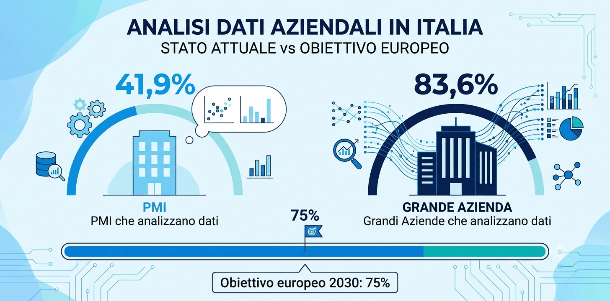
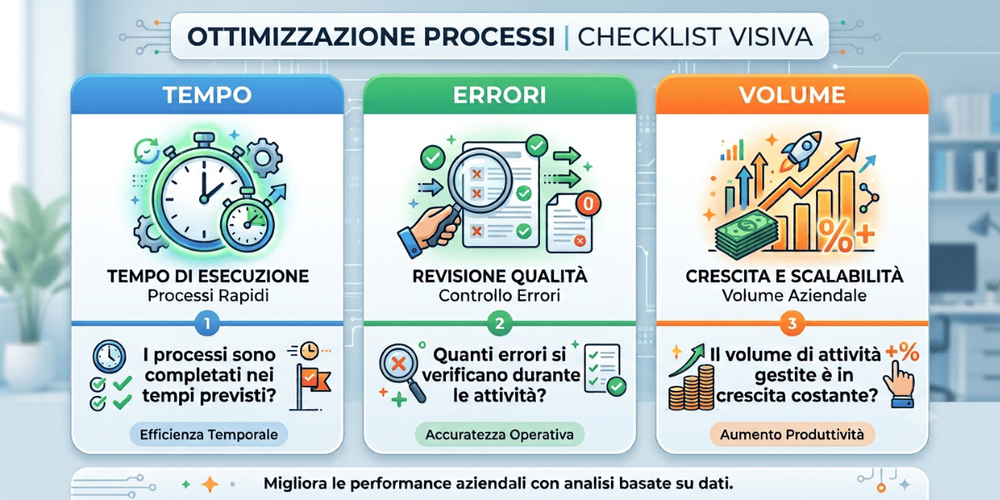
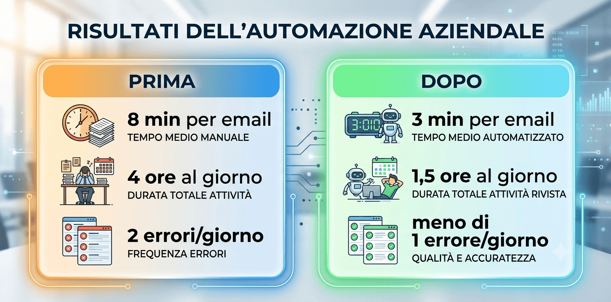

Dove si trova il numero di telefono dell’ultimo cliente che ha chiamato?

Hai introdotto uno strumento di AI nella tua azienda. O stai pensando di farlo nelle prossime settimane. Ma hai già risposto a questa domanda: come farai a sapere, tra sei mesi, se ha davvero funzionato?

Non è una domanda teorica. È la domanda più pratica che esiste e la maggior parte delle aziende non se la fa in anticipo. Il risultato è che, dopo mesi di utilizzo, non si riesce a dire se il tempo risparmiato è reale o percepito.

Non serve una dashboard elaborata. Non serve un analista. Bastano tre numeri scritti su un foglio prima di iniziare. Questo articolo ti spiega quali.

## Il problema che nessuno nomina: la mancanza di baseline

“Baseline” è una parola tecnica per un concetto semplice: sapere com’era prima.

Se vuoi capire se uno strumento AI ti sta aiutando a rispondere più velocemente alle email, devi sapere quanto tempo ci voleva prima. Se non lo hai misurato, tra sei mesi avrai solo una sensazione, non un dato. E una sensazione non basta per decidere se continuare a investire.

Il problema della baseline non è tecnico, ma di abitudine. La maggior parte degli imprenditori inizia a usare un nuovo strumento senza fermarsi a registrare il punto di partenza.

## Cosa significa misurare la baseline

Non serve un sistema di monitoraggio complesso. Serve rispondere a tre domande semplici, prima di iniziare:

-   Quanto tempo ci vuole adesso per fare questa attività?
-   Quante volte capita che vada storto?
-   Quante volte la settimana la facciamo?

Queste tre risposte sono la tua baseline. Scrivile su un foglio, in un’email a te stesso, su un Post-it. Il formato non conta. Conta averle.

## Quante PMI italiane misurano davvero i propri dati

Secondo [ISTAT](https://www.istat.it/comunicato-stampa/imprese-e-ict-anno-2025/), rilevazione “Imprese e ICT 2025”, solo il 41,9% delle PMI italiane svolge analisi dei dati in modo strutturato. Tra le grandi aziende la quota sale all‘83,6%. Nel biennio precedente le imprese che svolgevano analisi erano il 26,6%: la crescita c’è, ma siamo ancora lontani dall’obiettivo.

La [Commissione Europea](https://commission.europa.eu/strategy-and-policy/priorities-2019-2024/europe-fit-digital-age/europes-digital-decade-digital-targets-2030_it) ha fissato un obiettivo preciso: entro il 2030, il 75% delle imprese europee dovrà utilizzare cloud, big data o intelligenza artificiale in modo strutturato. Oggi siamo al 42,7% in Italia.

Questo non è un dato scoraggiante. Chi inizia a misurare adesso si posiziona in vantaggio rispetto alla maggioranza delle PMI italiane, che ancora gestisce i propri risultati “a sensazione”.

## Prima di iniziare, scrivi questi 3 numeri

Questi tre numeri non richiedono software, non richiedono competenze statistiche. Richiedono cinque minuti di attenzione prima di avviare qualsiasi processo con l’AI.

1\. Il tempo: quanto ci vuole adesso?

Scegli l’attività che vuoi migliorare con l’AI. Misura anche in modo approssimativo quanto tempo ci vuole oggi per farla.

Esempi: “rispondo a una email standard in circa 20 minuti”, “preparare un preventivo ci vuole 2 ore”, “aggiornare il report settimanale ci vuole mezza giornata”.

2\. Gli errori: quante volte va storto?

Pensa all’attività che vuoi migliorare. Quante volte, in una settimana o in un mese, produce un errore? Un dato sbagliato, un documento da rifare, una risposta che richiedeva una correzione?

Anche un numero approssimativo va bene: “sbagliamo circa 3-4 preventivi al mese” è una baseline perfettamente valida.

3\. Il volume: quante volte lo fai?

Quante volte a settimana (o al mese) si ripete l’attività che vuoi automatizzare? Questo numero moltiplica il valore di qualsiasi miglioramento.

Se risparmi 15 minuti su un’attività che fai una volta al mese, il beneficio annuo è di 3 ore. **Se la stessa attività la fai ogni giorno, il beneficio annuo è di quasi 100 ore.** Stessa percentuale di miglioramento, impatto completamente diverso.

## Come leggere i numeri dopo 30 giorni

Dopo un mese di utilizzo, torna ai tre numeri che hai scritto e confrontali con la situazione attuale.

Non cercare la perfezione: cerca la direzione. Le domande da farti sono semplici:

-   Il tempo è diminuito? Di quanto?
-   Gli errori sono diminuiti? O sono rimasti uguali?
-   Il volume è cambiato? (A volte un processo diventa più rapido e si inizia a farlo più spesso, segnale positivo.)

Tutti e tre i numeri migliorati? Hai la conferma che lo strumento sta funzionando. Se solo uno è migliorato, hai comunque un’informazione utile su dove concentrarti. Nessun cambiamento dopo 30 giorni significa che o il processo scelto non era quello giusto, o lo strumento non è stato usato con costanza.

## I KPI più utili per area

Ogni parte dell’azienda ha i propri numeri significativi. Ecco quelli più semplici da misurare, area per area.

**Area**

**KPI da misurare prima**

**Cosa cambia con l’AI**

**Commerciale**

**Tempo medio per preparare un preventivo**

**Si riduce; più preventivi nello stesso tempo**

**Commerciale**

**Follow-up effettuati ogni settimana**

**Aumentano perché i promemoria sono automatici**

**Customer service**

**Tempo medio di risposta a una richiesta**

**Diminuisce con risposte automatiche o bozze**

**Operativo**

**Numero di errori in un processo ricorrente**

**Diminuisce con automazione e controlli**

**Amministrativo**

**Ore su report e inserimento dati**

**Si riducono con estrazione e sintesi automatica**

**Generale**

**Ore settimanali su attività ripetitive**

**La metrica più semplice e più universale**

Uno scenario tipico

_Lo scenario seguente è un esempio illustrativo costruito per rendere concreto il concetto, non un caso reale._

Immagina un’azienda di servizi che gestisce una ventina di clienti attivi. Prima di introdurre uno strumento AI per la gestione delle email, il responsabile commerciale risponde in media a 30 email al giorno. Ogni risposta richiede circa 8 minuti. Totale: 4 ore al giorno.

Prima di iniziare, scrive tre numeri: tempo medio per risposta (8 minuti), errori (circa 2 al giorno), volume (30 email al giorno).

Dopo 30 giorni, le risposte standard vengono generate automaticamente in bozza. Il responsabile le rivede in circa 3 minuti ciascuna. Totale: 1,5 ore al giorno invece di 4. Il risparmio è di 2,5 ore al giorno. Su 20 giorni lavorativi, sono 50 ore al mese.

Questi tre numeri, confrontati con quelli di partenza, dicono chiaramente che lo strumento funziona.

## Errori comuni da evitare nella misurazione

-   **Misurare tutto invece di misurare qualcosa.** Una dashboard con venti KPI che nessuno guarda è peggio di tre numeri scritti a mano controllati ogni settimana.
-   **Non scrivere la baseline prima di iniziare.** Dopo un mese, la memoria del ‘com’era prima’ è già distorta. Il dato scritto in anticipo è l’unico affidabile.
-   **Aspettarsi risultati nei primi giorni.** Qualsiasi strumento nuovo ha una curva di apprendimento. Il confronto serio si fa dopo 30 giorni.
-   **Misurare solo il tempo, ignorando la qualità.** A volte un processo diventa più veloce ma anche meno accurato. Tenere traccia degli errori aiuta a vedere se il guadagno in velocità porta un costo in qualità.
-   **Smettere di misurare dopo il primo mese.** I benefici dell’AI crescono nel tempo. Una misurazione periodica, ogni trimestre, dà un quadro più preciso.

## Cosa cambia quando inizi a misurare

-   Puoi prendere decisioni basate su dati, non su impressioni.
-   Sai dove investire tempo e risorse per ottenere il massimo beneficio.
-   Puoi comunicare al team i risultati in modo concreto.
-   Hai una base per confrontare strumenti diversi se decidi di cambiare o espandere.
-   Costruisci una cultura aziendale orientata al miglioramento continuo.

## Vuoi misurare i risultati dell’AI nella tua azienda?

Sapere da dove iniziare è un passo. Sapere se stai andando nella direzione giusta è il passo successivo.

Con Innovazione PMI aiutiamo le aziende a definire [i KPI giusti per i loro processi specifici](/innovazione-dei-processi/), a costruire una baseline solida prima di introdurre qualsiasi strumento e a interpretare i risultati nel tempo.

[**Prenota una consulenza gratuita con Innovazione PMI**](/acceleratore-adozione-ai-call/)
