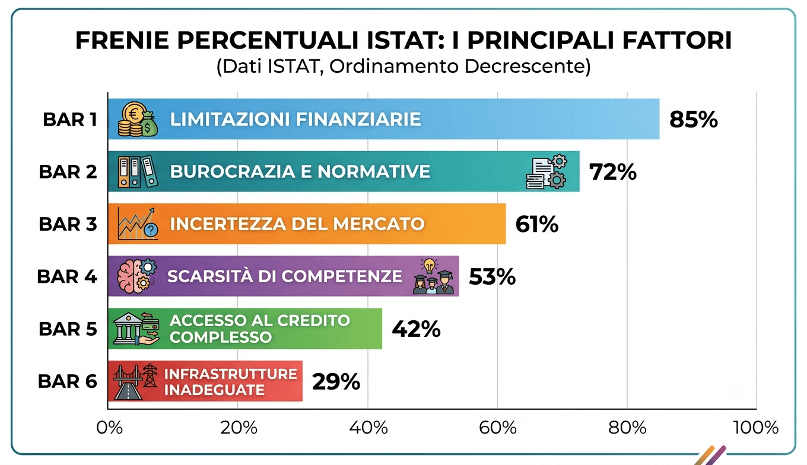
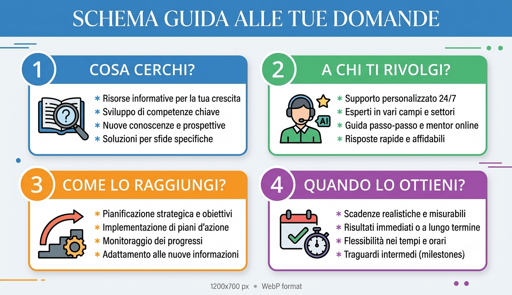
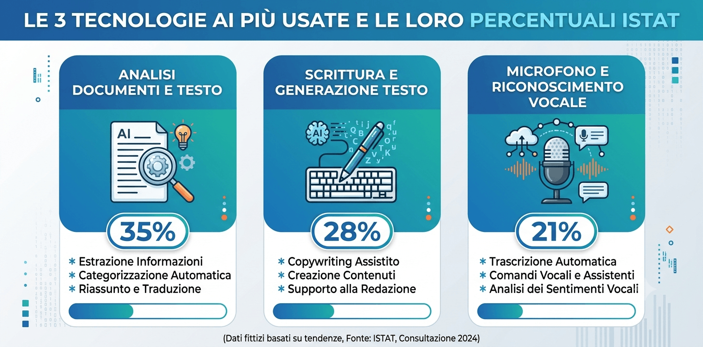
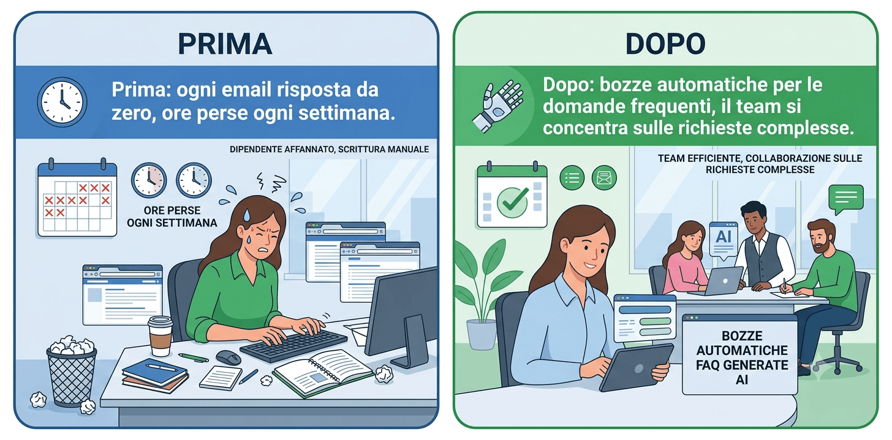

Hai sentito parlare di AI. Forse hai letto qualcosa, forse hai provato qualche strumento. Magari hai anche partecipato a un webinar o sentito un cliente entusiasta raccontare come “ha automatizzato tutto”.

Eppure, quando si tratta di capire da dove iniziare davvero nella tua azienda, la risposta non arriva mai. Ogni articolo dice qualcosa di diverso. Ogni fornitore propone la sua soluzione. E tu resti fermo non per mancanza di volontà, ma perché il punto di partenza non è chiaro.

Se è questa la situazione, sei in buona compagnia. Quasi il 20% delle imprese italiane ha già in programma investimenti in AI per i prossimi due anni, ma la maggior parte non sa ancora da dove iniziare. Non è un problema di risorse o di tecnologia. **È un problema di metodo.**

Questo articolo non ti dirà quale software comprare. Ti aiuterà a capire le domande giuste da farti prima di scegliere qualsiasi strumento.

## Perché è difficile iniziare, i freni reali

Prima di capire da dove iniziare, vale la pena capire perché così tante aziende restano ferme. Non è pigrizia. Sono ostacoli concreti.

I sei freni dichiarati dalle aziende italiane

Secondo [ISTAT](https://www.istat.it/comunicato-stampa/imprese-e-ict-anno-2025/), rilevazione “Imprese e ICT 2025”, le aziende italiane che hanno valutato un investimento in AI senza poi realizzarlo indicano questi ostacoli principali:

-   **Mancanza di competenze adeguate:** 58,6%
-   **Scarsa chiarezza normativa:** 47,3%
-   **Qualità o disponibilità dei dati insufficiente:** 45,2%
-   **Preoccupazioni su privacy e protezione dati:** 43,2%
-   **Costi elevati:** 43,0%
-   **Considerazioni etiche:** 25,7%

Il dato più interessante: i costi sono solo al quinto posto. Il problema principale non è “non ho i soldi”, è “non so come farlo” e “non so se è legale farlo”.

Il freno più sottovalutato: non sapere qual è il problema giusto da risolvere

C’è però un ostacolo che non compare in nessuna statistica, perché nessuno lo dichiara esplicitamente. Ed è il più comune di tutti.

Molte aziende non sanno da dove iniziare perché non hanno ancora identificato il problema specifico che vogliono risolvere. Pensano all’AI come a una soluzione generica. Senza un problema preciso, qualsiasi strumento sembra sbagliato o troppo grande.

Il momento giusto non arriva mai da solo. Arriva quando si smette di cercare lo strumento perfetto e si inizia dall’analisi del problema.

## Prima di scegliere uno strumento, rispondi a queste 4 domande

Queste domande non richiedono competenze tecniche. Richiedono solo onestà su come funziona davvero la tua azienda.

1\. Quale attività mi costa più tempo ogni settimana?

Pensa alla tua settimana tipica. C’è qualcosa che fai tu, o che fa il tuo team, in modo ripetitivo, che segue sempre lo stesso schema, e che porta via ore senza aggiungere valore reale?

Esempi comuni: rispondere alle stesse domande dei clienti, compilare preventivi standard, riassumere email o documenti, aggiornare fogli Excel con dati che arrivano da altri sistemi, preparare report periodici.

2\. Dove commetto più errori ripetitivi?

Gli errori più costosi non sono quelli clamorosi. Sono quelli piccoli e ripetuti: un dato copiato male, un preventivo con un prezzo sbagliato, una scadenza mancata perché nessuno l’aveva tracciata.

Dove si concentrano questi piccoli errori? Quel punto è un candidato eccellente per l’AI, perché l’AI non si stanca e non si distrae.

3\. Cosa potrebbe fare qualcun altro se avesse le stesse informazioni che ho io?

Questa domanda identifica le attività che dipendono dalla conoscenza di una persona specifica, ma che potrebbero essere gestite da chiunque se quelle [informazioni fossero accessibili e strutturate](/aibox/).

Se la risposta è “quasi tutto, basterebbe avere il contesto giusto”, quello è un ottimo candidato per l’AI.

4\. Qual è il processo che si blocca quando manca una persona?

Se un processo si blocca ogni volta che qualcuno è assente, significa che dipende interamente da quella persona. Automatizzare anche solo una parte di quel processo riduce la fragilità dell’azienda.

## Le tecnologie AI che le PMI italiane usano davvero

Secondo [ISTAT](https://www.istat.it/comunicato-stampa/imprese-e-ict-anno-2025/), le tecnologie AI più usate nelle imprese italiane sono:

-   **Estrazione di informazioni da testi:** 54,5% delle aziende che usano AI
-   **AI generativa di contenuti scritti o parlati:** 45,3% (nelle PMI sale al 46,9%)
-   **Riconoscimento vocale:** 39,9%

Tradotto in pratica: rispondere automaticamente alle email standard, generare bozze di preventivi, trascrivere riunioni o telefonate, estrarre informazioni da contratti o fatture. Attività che esistono già in ogni azienda.

Secondo [Eurostat](https://ec.europa.eu/eurostat/web/products-eurostat-news/w/ddn-20251211-2), il 20% delle imprese europee con almeno 10 addetti usa già almeno una tecnologia AI. Non sono tutte aziende tecnologiche: sono aziende di servizi, manifattura, commercio, molto simili alla tua.

## Un percorso in 4 fasi per iniziare

-   **Scegli un processo solo.** Non il più importante, non quello che cambierebbe tutto. Scegli il più piccolo tra quelli che hai identificato. Più è circoscritto, più è facile misurare se funziona.
-   **Testa uno strumento semplice per 30 giorni.** Non serve comprare nulla di costoso. Molti strumenti di AI si possono usare gratuitamente. Usalo su quel processo specifico per un mese.
-   **Misura il risultato in modo semplice.** Quanto tempo impiegavi prima? Quanto impieghi adesso? Non servono dashboard elaborate. Basta un numero che dica ‘prima X, adesso Y’.
-   **Decidi se estendere o cambiare processo.** Se il risultato è positivo, espandi. Se non funziona, scegli un processo diverso. L’obiettivo del primo tentativo non è il successo garantito: è imparare qualcosa di utile.

## Uno scenario tipico

_Lo scenario seguente è un esempio illustrativo costruito per rendere concreto il percorso, non un caso reale._

Immagina il titolare di uno studio di consulenza fiscale con 8 collaboratori. Ogni settimana ricevono decine di email con domande simili da clienti diversi: scadenze, documenti da inviare, spiegazioni su adempimenti.

Partendo dalla prima domanda (“quale attività mi costa più tempo?”), il titolare identifica esattamente questo processo. In 30 giorni, con uno strumento di AI generativa, inizia a usare bozze di risposta automatiche per le domande più frequenti. Il team le personalizza e le invia.

Il risultato non è la scomparsa del lavoro. Lo stesso lavoro richiede meno tempo. Il team si concentra sulle domande complesse. Le risposte standard arrivano più velocemente.

Nessuna rivoluzione tecnologica. Un processo solo, migliorato in modo misurabile.

## Errori comuni da evitare

-   **Iniziare dalla tecnologia invece che dal problema.** “Voglio usare ChatGPT” non è un punto di partenza. “Voglio ridurre il tempo che passo a scrivere preventivi” lo è.
-   **Scegliere un processo troppo complesso per il primo tentativo.** Il primo esperimento deve poter fallire senza danni. Scegli qualcosa di marginale, non qualcosa di critico.
-   **Aspettarsi risultati senza misurare nulla.** Senza una baseline (“prima ci volevano 3 ore”), non puoi sapere se stai migliorando.
-   **Delegare tutto a un fornitore senza capire cosa sta facendo.** Non serve essere tecnici: serve capire cosa lo strumento fa e cosa non fa.
-   **Fermarsi al primo tentativo non riuscito.** Il primo processo che scegli potrebbe non essere quello giusto. Significa che hai imparato quale processo saltare.

## Cosa cambia quando inizi nel modo giusto

-   Smetti di aspettare il “momento giusto” e inizi ad accumulare esperienza reale.
-   Impari cosa funziona nella tua azienda specifica, non in una azienda generica.
-   Costruisci la fiducia del team verso gli strumenti nuovi, un passo alla volta.
-   Hai dati concreti su cui basare le decisioni successive, invece di valutazioni teoriche.
-   Riduci il rischio: un piccolo esperimento che non funziona costa poco. Un grande progetto mal pianificato costa moltissimo.

## Vuoi capire da dove iniziare nella tua azienda specifica?

Le 4 domande di questo articolo sono un buon punto di partenza. Ma il passo successivo, capire quale processo scegliere, quale strumento testare e come misurare i risultati dipende da come funziona la tua azienda.

Con Innovazione PMI [analizziamo i processi della tua azienda](/innovazione-dei-processi/), identifichiamo il punto di partenza più adatto alla tua situazione e costruiamo un percorso concreto per i primi 90 giorni, senza stravolgere il lavoro quotidiano del tuo team.

[**Prenota una consulenza gratuita con Innovazione PMI**](/acceleratore-adozione-ai-call/)
