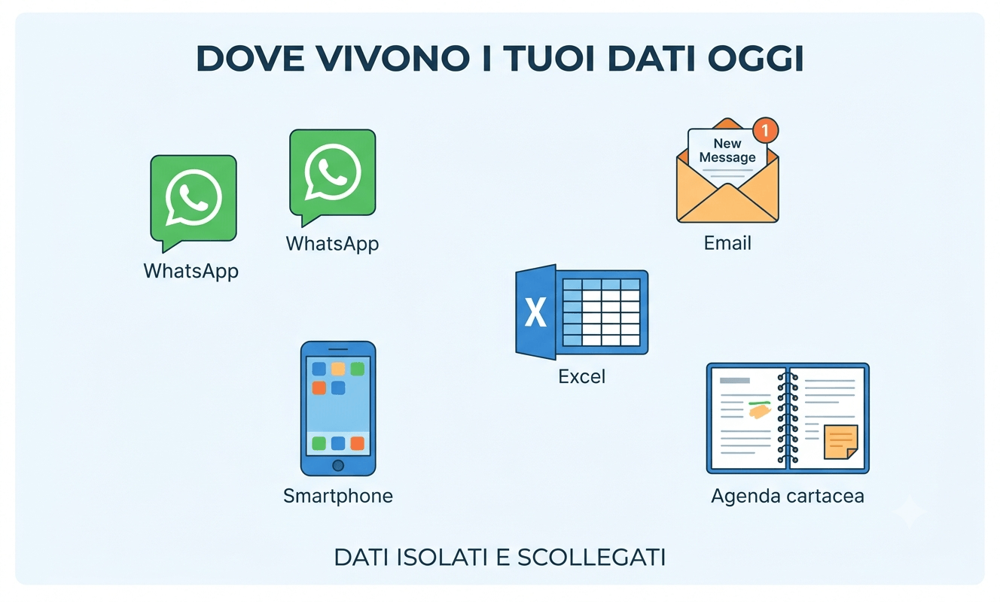
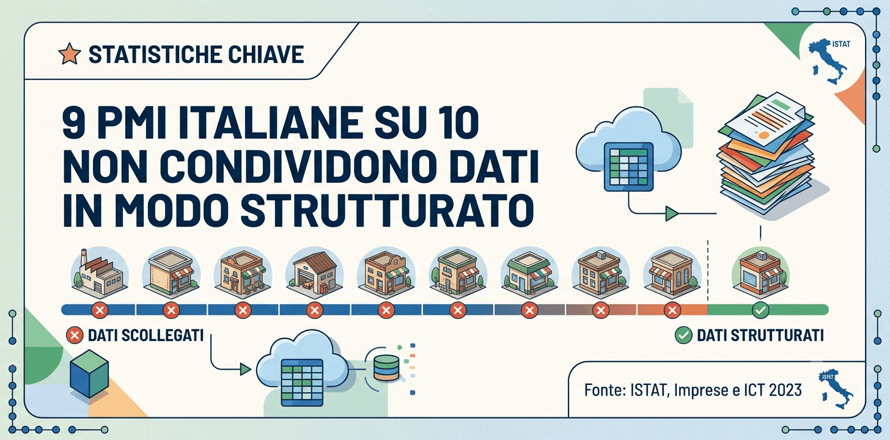
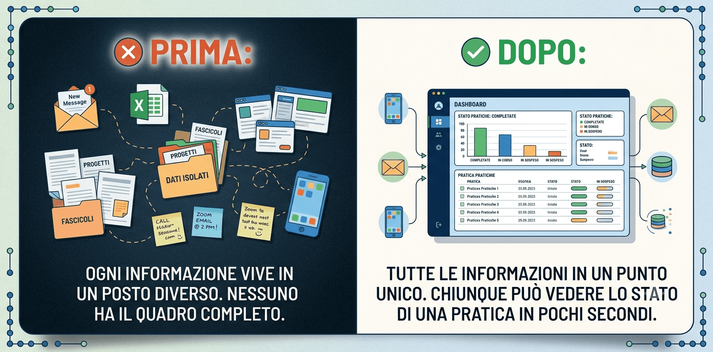
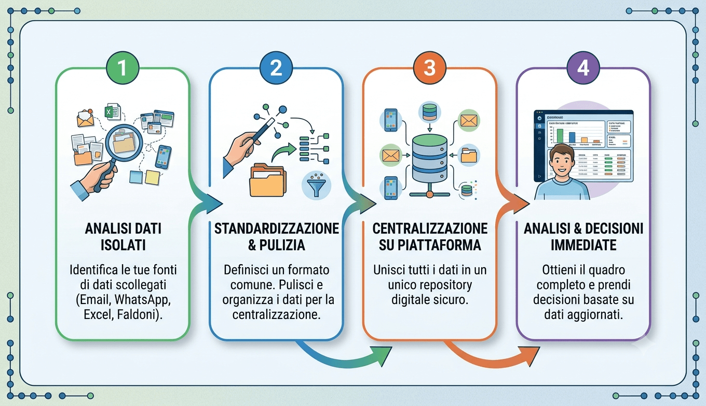

## Dove si trova il numero di telefono dell’ultimo cliente che ha chiamato?

Nel telefono del commerciale. Forse su un foglio Excel che nessuno aggiorna da tre mesi. Magari in una mail sepolta nella casella di qualcuno che oggi è in ferie. O su un post-it appiccicato al monitor.

Se hai risposto “dipende”, sei in buona compagnia. La maggior parte delle PMI italiane vive esattamente questa situazione ogni giorno. I dati ci sono. Il problema è che sono nel posto sbagliato.

E questo costa in tempo perso, in errori evitabili, in rischi che non si vedono finché non è troppo tardi.

## I segnali che i tuoi dati sono sparsi

Riconosci qualcuna di queste situazioni?

-   Per rispondere a un cliente devi cercare in tre posti diversi prima di trovare l’informazione giusta.
-   Le informazioni su un ordine o una trattativa stanno nella testa di una persona sola.
-   Quando qualcuno è assente, le sue pratiche si fermano perché nessun altro sa dove sono le informazioni.
-   Esistono più versioni dello stesso file Excel, e nessuno sa quale sia quella giusta.
-   I dati arrivano via WhatsApp, email e telefono. Vengono copiati a mano su un foglio o un gestionale.
-   Non esiste un posto unico dove vedere lo stato di tutti i lavori o le trattative in corso.

Se ti riconosci anche solo in due di questi punti, il problema esiste. E sta costando più di quanto pensi.

## Quanto è diffuso davvero il problema nelle PMI italiane

Non è una questione di dimensione o di settore. È un problema strutturale che riguarda la grande maggioranza delle imprese italiane.

**Il dato ISTAT: solo 1 PMI su 10 condivide dati in modo strutturato**

Secondo [ISTAT](https://www.istat.it/comunicato-stampa/imprese-e-ict-anno-2023/), rilevazione “Imprese e ICT 2023”, solo il 13,6% delle PMI italiane condivide dati elettronicamente con clienti e fornitori nella catena di approvvigionamento. La media europea è del 23,5%.

Significa che quasi 9 PMI su 10 gestisce ancora le informazioni con strumenti non strutturati. Email, telefonate, file condivisi in modo informale, fogli Excel aggiornati a mano.

Non è una critica. È la fotografia di come funzionano davvero la maggior parte delle aziende italiane. Il problema non è la buona volontà. È che nessuno ha mai messo mano al modo in cui le informazioni circolano dentro e fuori l’azienda.

## Avere uno strumento non significa usarlo davvero

C’è un secondo dato che vale la pena guardare. Sempre secondo [ISTAT](https://www.istat.it/comunicato-stampa/imprese-e-ict-anno-2025/), rilevazione 2025, solo il 41,9% delle PMI italiane fa analisi dei dati in modo strutturato. Tra le grandi aziende la quota sale all’83,6%.

Per i software gestionali il divario è simile: il 48,8% delle PMI usa un ERP, contro l’85,9% delle grandi aziende. Per i CRM: 21,1% le PMI, 56,5% le grandi.

Il punto non è solo quante aziende hanno uno strumento. È quante lo usano davvero per capire cosa sta succedendo. Avere un gestionale e continuare a mandare le misure via WhatsApp sono due cose che coesistono facilmente e in molte aziende coesistono.

## Quanto costa davvero il caos informativo

Il costo dei dati sparsi ha due facce. Una è visibile ogni giorno. L’altra si vede solo quando è troppo tardi.

### Il costo quotidiano: il tempo perso a cercare

Secondo uno studio McKinsey, i lavoratori trascorrono in media quasi il 20% della loro settimana lavorativa a cercare informazioni interne. Su una settimana di cinque giorni, è quasi una giornata intera. Per ogni persona.

_Nota: questo dato viene da una ricerca McKinsey sul lavoro della conoscenza e si riferisce a un contesto internazionale, va letto come ordine di grandezza, non come misura precisa per ogni PMI italiana._

Anche se nella tua azienda il tempo fosse la metà, stiamo parlando di ore significative ogni settimana per ogni persona. Moltiplica per il numero di collaboratori. Moltiplica per 52 settimane. Il risultato è il costo invisibile del caos informativo, che non appare in nessuna voce di bilancio, ma si sente ogni giorno.

### Il rischio strategico: quando una persona parte, i dati spariscono

Questo è il costo meno visibile. Ed è quello che può fare più danni.

Immagina un commerciale che gestisce da solo venti clienti. Conosce cosa ha promesso a ciascuno, le loro preferenze e i prezzi concordati. Sa dove si trovano le ultime email, i preventivi e le note sulle telefonate.

Poi lascia l’azienda. O si ammala. O è in ferie per due settimane.

Quante di quelle informazioni sopravvivono senza di lui?

Nella maggior parte delle PMI, la risposta è: pochissime. Le informazioni non erano nell’azienda. Erano nella testa, e nel telefono, di quella persona. Questo è il rischio più sottovalutato dei dati sparsi. Non è solo un problema di produttività. **È un problema di continuità del business.**

## Perché succede anche nelle aziende organizzate

Il caos informativo non nasce dalla disorganizzazione. Di solito nasce dalla crescita.

Quando un’azienda è piccola, basta la memoria del titolare. Con la crescita arrivano nuovi collaboratori. I canali di comunicazione si moltiplicano progressivamente. Ogni strumento nasce per risolvere un problema specifico. Nessuno si ferma mai a chiedersi dove finiscono le informazioni importanti.

Il risultato è un archivio invisibile, fatto di migliaia di messaggi, file, appunti e conversazioni che nessuno riesce più a navigare in modo efficiente.

Non è colpa di nessuno. È quello che succede naturalmente quando i processi crescono senza una struttura che li governi.

## Uno scenario tipico

_Lo scenario seguente è un esempio illustrativo. Non è un caso reale._

Immagina un’azienda di assistenza tecnica con 18 dipendenti. I clienti chiamano, mandano email, scrivono su WhatsApp. I tecnici prendono appunti sui loro telefoni o su fogli cartacei. A fine giornata, qualcuno aggiorna un foglio Excel condiviso, ma non sempre.

Quando un cliente richiama per sapere a che punto è la sua pratica, serve trovare chi ha gestito l’intervento. Capire dove ha lasciato le note. Recuperare la mail con i dettagli tecnici.

Nel frattempo, il cliente aspetta. Il tecnico interrompe quello che sta facendo. Il titolare non ha mai un quadro chiaro di quante pratiche sono aperte.

Nessuno lo fa di proposito. Tutti lavorano sodo. Ma il sistema non funziona e il costo si accumula in silenzio ogni giorno.

## Da dove iniziare, ecco i 4 passi pratici

-   **Mappa dove vivono oggi le informazioni importanti.** Fai un elenco dei canali dove arrivano e dove finiscono le informazioni critiche. Scrivi tutto, anche quello che sembra ovvio.
-   **Identifica i tre tipi di informazione che si perdono più spesso.** Non partire da tutto insieme. Scegli i dati più critici, quelli che, quando mancano, creano problemi reali.
-   **Scegli un punto unico di raccolta per quelle tre categorie.** Può essere un CRM semplice, un gestionale già in uso ma non sfruttato. L’importante è che tutti lo usino.
-   **Stabilisci una regola semplice su chi inserisce i dati e quando.** Senza una regola chiara, il nuovo sistema diventa l’ennesimo posto dove le informazioni finiscono in modo parziale.

## Errori comuni da evitare

-   **Comprare uno strumento prima di aver capito il problema.** Un nuovo gestionale non risolve il caos se il processo resta invariato.
-   **Voler centralizzare tutto in una volta.** Inizia da un’area sola. Espandi solo dopo che funziona.
-   **Non coinvolgere chi usa i dati ogni giorno.** Se le persone non capiscono perché il nuovo sistema è utile per loro, lo useranno poco e male.
-   **Pensare che il problema si risolva da solo crescendo.** Senza un intervento strutturato, il caos informativo peggiora con la crescita, non migliora.

## Cosa cambia quando i dati sono centralizzati

-   Chiunque trova le informazioni che servono. Senza dover chiedere a nessuno.
-   Le pratiche non si fermano quando una persona è assente.
-   Il titolare vede il quadro completo senza raccogliere aggiornamenti da ogni membro del team.
-   Le decisioni si basano su dati reali, non su impressioni o ricordi.
-   L’azienda non dipende dalla memoria di una sola persona.

## Vuoi capire dove si perdono le informazioni nella tua azienda?

Il primo passo non è comprare uno strumento. È capire dove si rompono i flussi informativi oggi.

Con Innovazione PMI [analizziamo come circolano le informazioni nella tua azienda](/innovazione-dei-processi/). Individuiamo i punti critici. Costruiamo un percorso semplice per centralizzare i dati senza stravolgere il lavoro del team.

[**Prenota una consulenza gratuita con Innovazione PMI**](/acceleratore-adozione-ai-call/)
