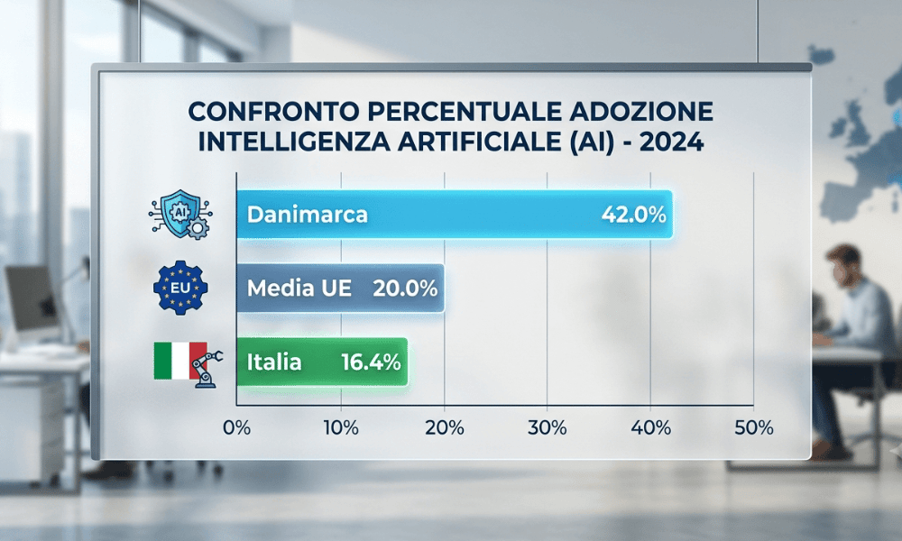
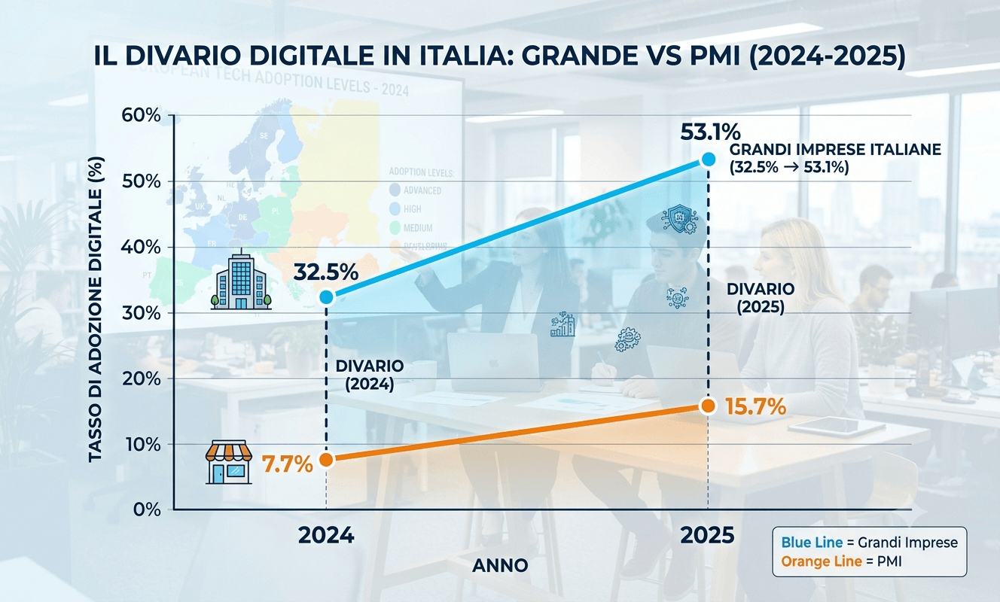
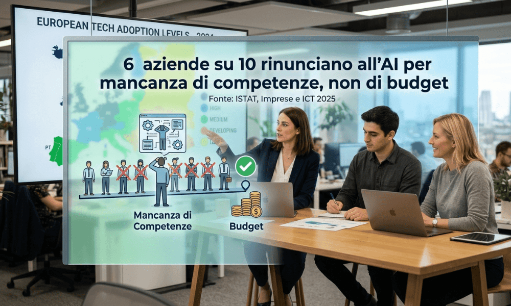
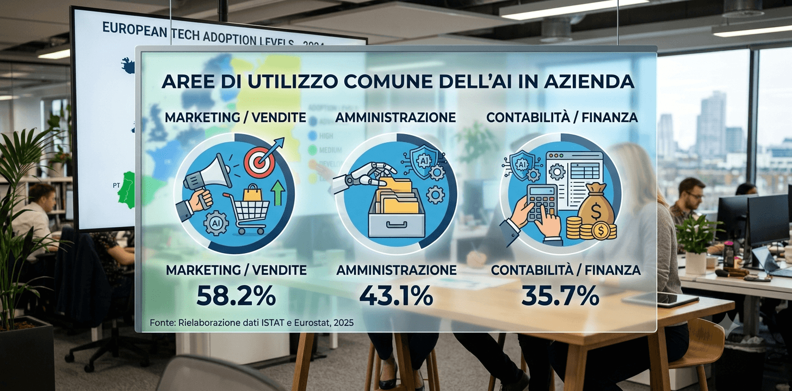
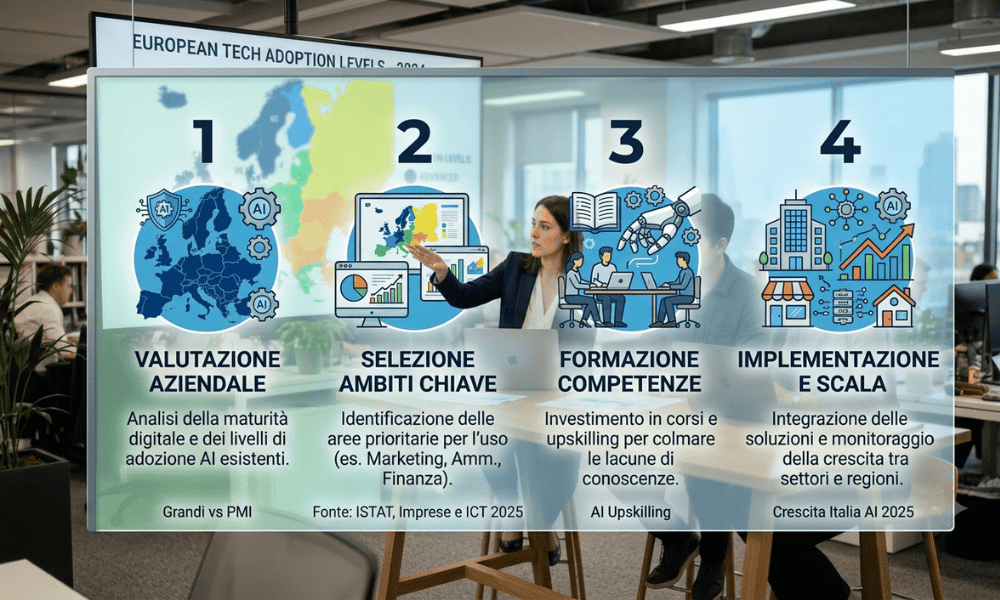

## Quanti preventivi hai mandato questo mese? E quanti hai richiamato per sapere se erano ancora interessati?

Negli ultimi due anni l’intelligenza artificiale è entrata nelle aziende molto più velocemente di quanto si pensi. Ma non è entrata ovunque allo stesso modo. Alcune aziende la usano già ogni giorno per attività concrete come rispondere ai clienti, organizzare preventivi, analizzare dati di vendita. Altre non l’hanno ancora nemmeno provata, spesso non perché non ne vedano il valore, ma perché non sanno da dove cominciare.

Questo articolo guarda ai numeri reali su quante aziende usano l’AI oggi e dove si colloca l’Italia rispetto al resto d’Europa. Soprattutto, spiega perché molte PMI restano indietro e la risposta ha poco a che fare con la tecnologia in sé.

## Quanto è diffusa davvero l’AI nelle aziende

I numeri ufficiali raccontano una crescita rapida, ma diseguale.

A livello europeo, secondo [Eurostat](https://ec.europa.eu/eurostat/web/products-eurostat-news/w/ddn-20251211-2), nel 2025 il 19,95% delle imprese con almeno 10 addetti utilizza almeno una tecnologia di intelligenza artificiale, contro il 13,5% del 2024. È una crescita importante in un solo anno.

In Italia, secondo [ISTAT](https://www.istat.it/comunicato-stampa/imprese-e-ict-anno-2025/), la quota di imprese che usa l’AI è arrivata al 16,4% nel 2025. Era l’8,2% nel 2024 e il 5,0% nel 2023. La crescita è rapida, ma parte da un punto più basso e resta sotto la media UE.

In cima alla classifica europea troviamo Danimarca (42%), Finlandia (37,8%) e Svezia (35%): paesi dove più di un’azienda su tre usa già l’AI, più del doppio della quota italiana.

## Il vero gap non è con l’estero, è dentro l’Italia

Qui arriva il dato più interessante, e quello che cambia la prospettiva sull’intero tema.

Il divario maggiore non è tanto tra l’Italia e gli altri paesi europei, quanto **tra le grandi aziende italiane e le PMI italiane.** Le grandi imprese sono passate dal 32,5% di adozione AI nel 2024 al 53,1% nel 2025 più di una su due usa già l’AI. Le PMI, nello stesso periodo, sono passate dal 7,7% al 15,7%: raddoppiano anche loro, ma restano molto più indietro.

Il divario tra grandi aziende e PMI italiane non si sta riducendo: stava allargando. Era di circa 20 punti nel 2023, è arrivato a 37 punti nel 2025. Mentre le grandi aziende accelerano, le PMI faticano a tenere il passo non solo rispetto all’estero, ma rispetto alle aziende italiane più grandi.

Questo schema non è una particolarità italiana: anche a livello europeo, le piccole imprese usano l’AI nel 17% dei casi, le medie nel 30,4%, le grandi nel 55%. La dimensione aziendale conta ovunque. Ma in Italia il distacco tra PMI e grandi aziende è più marcato, ed è quello che vale la pena guardare da vicino.

## Perché succede — non è un problema di soldi o di fiducia

A questo punto verrebbe naturale pensare che le PMI italiane siano indietro perché l’AI costa troppo, o perché non si fidano della tecnologia. I dati raccontano una storia diversa.

**Secondo ISTAT, quasi il 60% delle aziende italiane che hanno valutato un investimento in AI, ma poi non l’hanno realizzato, indica la mancanza di competenze adeguate come motivo principale.** Al secondo posto, segnalato dal 47,3% delle aziende, c’è la scarsa chiarezza normativa.

Questo è un dato importante perché sposta il problema da “la tecnologia” a “le persone che dovrebbero usarla”. Non è che le PMI non vogliano l’AI o non ne vedano il valore. Il punto è che molte ci hanno pensato, hanno valutato, e poi si sono fermate. Non sapevano come muoversi concretamente: chi se ne occupa, con quali strumenti, partendo da cosa.tendo da cosa.

È una buona notizia, in un certo senso: un problema di competenze si può colmare. Un problema di “la tecnologia non funziona per noi” sarebbe molto più difficile da risolvere.

## Cosa fanno davvero le aziende che usano l’AI

Un altro malinteso comune è pensare che l’intelligenza artificiale, in azienda, significhi qualcosa di complesso e lontano dal lavoro quotidiano come robot, sistemi avanzati, progetti enormi.

I dati dicono il contrario. A livello europeo, l’uso più comune dell’AI riguarda il marketing e le vendite (34,7%), seguito dall’amministrazione (31,1%) e dalla contabilità (23,1%). In Italia lo schema è simile: marketing e vendite al 33,1%, amministrazione al 25,7%, ricerca e sviluppo al 20%.

In altre parole, le aziende che usano l’AI oggi lo fanno soprattutto per attività molto concrete: rispondere più velocemente ai clienti, organizzare meglio i preventivi, automatizzare parti ripetitive della contabilità, analizzare i dati di vendita per capire cosa funziona. Non si tratta di reinventare l’azienda, ma di alleggerire compiti che già esistono.

## Uno scenario tipico

_Lo scenario seguente è un esempio illustrativo costruito per rendere concreto il problema, non un caso reale._

Immagina due aziende di servizi alle imprese, della stessa dimensione, nello stesso settore. La prima gestisce tutto come ha sempre fatto: preventivi a mano, risposte ai clienti quando c’è tempo, report su Excel a fine mese. La seconda ha iniziato a usare un tool di AI per velocizzare i preventivi standard. E per riassumere automaticamente le richieste in arrivo via email.

Non è una differenza enorme nel breve termine. Ma su un anno, la seconda azienda risponde più velocemente, perde meno tempo su attività ripetitive, e il titolare ha più ore libere per occuparsi di clienti e strategia invece che di scartoffie. Nessuna delle due aziende ha “investito in AI” in senso tradizionale: una ha semplicemente iniziato a usare uno strumento, con un piccolo passo, mentre l’altra ha rimandato.

Questo è il punto centrale del divario che abbiamo visto nei dati: non serve un grande progetto per iniziare a colmarlo. Serve iniziare.

## Da dove iniziare — passi pratici

Riconosci qualcuna di queste situazioni?

-   **Individua un’attività ripetitiva e a basso rischio.** Non partire dal processo più complesso o più delicato dell’azienda. Scegli qualcosa di ripetitivo come rispondere a domande frequenti, riassumere documenti, organizzare informazioni quindi dove un errore non crea danni gravi.
-   **Prova uno strumento semplice, senza impegno a lungo termine.** Molti strumenti di AI oggi si possono testare gratuitamente o con costi minimi. Non serve comprare una soluzione complessa al primo tentativo.
-   **Coinvolgi una persona, non un reparto.** Non serve un team tecnico interno per iniziare: basta che qualcuno in azienda dedichi un po’ di tempo a capire come integrare lo strumento in un singolo processo.
-   **Misura il risultato prima di allargare l’uso.** Quanto tempo si risparmia? Quanto migliora la qualità del lavoro? Solo dopo aver visto un beneficio concreto su un processo piccolo ha senso estendere l’uso dell’AI ad altre aree.

## Errori comuni da evitare

-   **Aspettare di avere “tutte le competenze” prima di iniziare.** Le competenze si costruiscono usando lo strumento su un caso reale, non studiando in astratto prima di provare.
-   **Pensare che serva un team tecnico interno.** Molti strumenti di AI oggi sono pensati per essere usati senza competenze di programmazione.
-   **Confondere l’AI con la sostituzione del personale.** Nella maggior parte dei casi reali, l’AI toglie tempo da attività ripetitive, non sostituisce le persone che si occupano di relazioni con i clienti o decisioni strategiche.
-   **Partire da un progetto troppo grande.** Un progetto ambizioso senza prima aver testato nulla è il modo più comune per restare fermi a “ci stiamo pensando” per anni.

## Cosa cambia quando colmi il divario

-   Smetti di rincorrere i tempi delle aziende più strutturate, che già usano l’AI per essere più rapide ed efficienti.
-   Liberi tempo del titolare e del team da attività ripetitive, per dedicarlo a clienti e decisioni che contano davvero.
-   Costruisci competenze interne in modo graduale, senza dover affrontare un progetto enorme da subito.
-   Riduci il rischio di restare indietro rispetto a concorrenti che, anche nel tuo stesso settore, stanno già iniziando.” per anni.

## Vuoi capire da dove iniziare con l’AI nella tua azienda?

Non serve un grande progetto per iniziare a colmare il divario: serve individuare il punto giusto da cui partire. Con Innovazione PMI [analizziamo i processi della tua azienda](/innovazione-dei-processi/) e [individuiamo dove l’AI può portare un beneficio concreto e misurabile](/acceleratore-adozione-ai-call/). Costruiamo poi un percorso semplice per iniziare, senza stravolgere il lavoro quotidiano.

[**Prenota una consulenza gratuita con Innovazione PMI**](/acceleratore-adozione-ai-call/)
