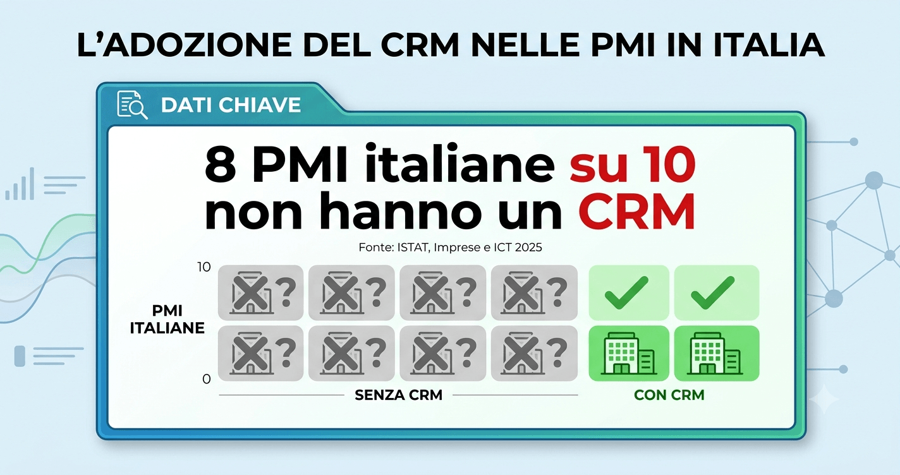
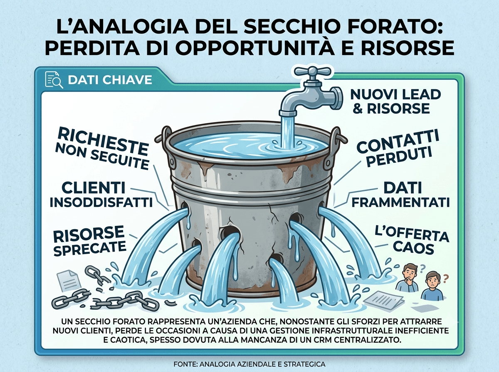
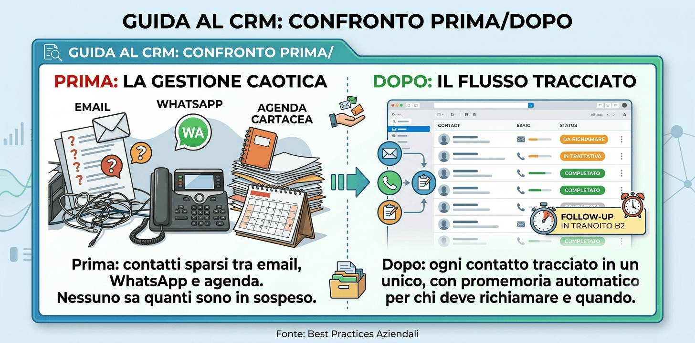
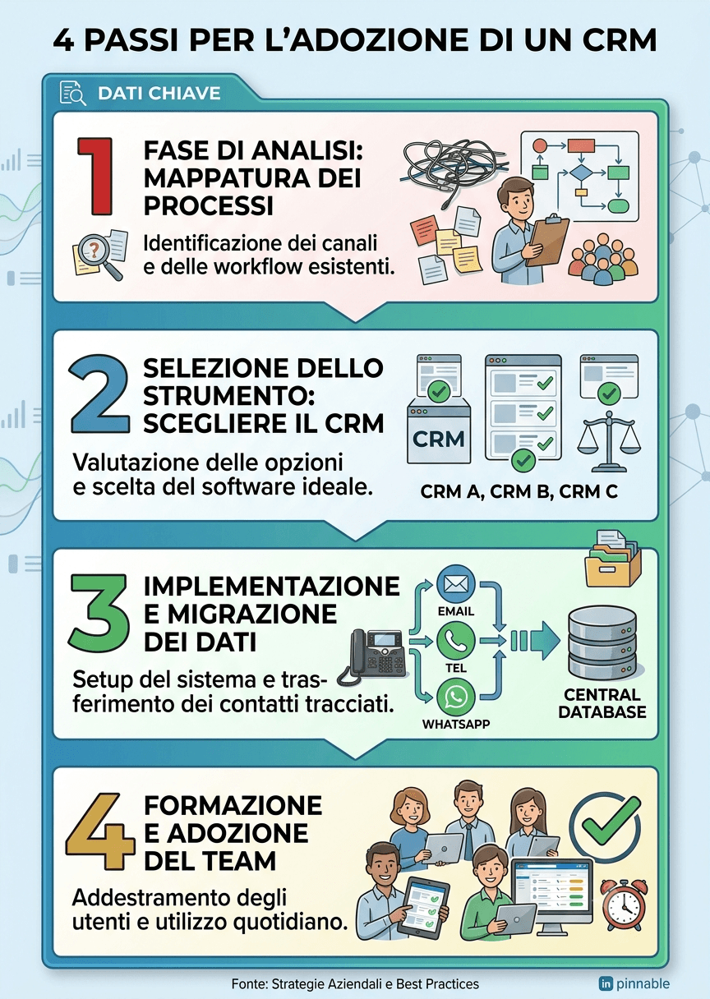

## Quanti preventivi hai mandato questo mese? E quanti hai richiamato per sapere se erano ancora interessati?

Se non sai rispondere con un numero preciso, non sei il solo. Nella maggior parte delle piccole e medie imprese italiane nessuno tiene davvero il conto. I preventivi partono, alcuni clienti rispondono, altri restano in silenzio e dopo qualche settimana quel contatto è semplicemente sparito. Non perché il cliente non fosse interessato. Spesso, semplicemente, perché nessuno l’ha richiamato in tempo.

È uno dei problemi più costosi e meno visibili che un’azienda possa avere: non si vede in bilancio come una voce di spesa, ma si sente nei ricavi che non arrivano.

## I segnali che la tua azienda sta perdendo lead

Riconosci qualcuna di queste situazioni?

-   I contatti dei potenziali clienti sono divisi tra email, WhatsApp, agenda cartacea e la memoria del titolare o del commerciale.
-   Un preventivo viene inviato e, se il cliente non risponde da solo, nessuno lo richiama.
-   Quando un commerciale è in ferie o malattia, le sue trattative si fermano o si perdono.
-   Non esiste un modo semplice per sapere quanti contatti sono “in sospeso” in questo momento.
-   Le decisioni su chi richiamare e quando si basano sulla memoria, non su un sistema.

Se ti riconosci anche solo in due di questi punti, è molto probabile che la tua azienda stia perdendo fatturato senza saperlo.

## Perché succede anche in aziende che lavorano bene

Non è un problema di disorganizzazione personale. È un problema strutturale, ed è molto più diffuso di quanto si pensi.

**Il dato [ISTAT](https://www.istat.it/comunicato-stampa/imprese-e-ict-anno-2025/)**

Secondo l’ultima rilevazione [ISTAT](https://www.istat.it/comunicato-stampa/imprese-e-ict-anno-2025/) “Imprese e ICT” (dicembre 2025), solo il 21,1% delle piccole e medie imprese italiane utilizza un software CRM per gestire le informazioni sui clienti, contro il 56,5% delle grandi aziende. In altre parole: **quasi 8 PMI italiane su 10 non hanno uno strumento dedicato a tracciare i propri contatti commerciali**, e gestiscono tutto “a mano” con tutti i rischi che questo comporta.

Non significa che il 79% delle aziende stia lavorando male. Significa che la maggior parte delle PMI italiane affronta questo problema con gli strumenti sbagliati per il volume di lavoro che ha oggi.

## Il vero costo di un lead non seguito

L’analogia del secchio bucato

Immagina di versare acqua in un secchio che ha dei piccoli buchi sul fondo. Più acqua versi (più budget metti in pubblicità, fiere, passaparola), più acqua esce dai buchi. Da fuori sembra che il secchio si stia riempiendo in realtà, una parte di quello che versi sta già uscendo senza che tu te ne accorga.

I lead non seguiti sono i buchi nel secchio. Puoi aumentare il budget di marketing tutto l’anno, ma se una parte dei contatti generati evapora per mancanza di follow-up, stai pagando due volte lo stesso problema: una volta per generare il contatto, una seconda volta (in fatturato perso) per non averlo seguito.

## Cosa dicono i dati internazionali sul tempo di risposta

Su questo tema esistono ricerche internazionali molto solide americane, quindi da leggere come spiegazione del meccanismo, non come fotografia dell’Italia.

Uno studio della [Harvard Business Review](https://hbr.org/2011/03/the-short-life-of-online-sales-leads) (Oldroyd, McElheran, Elkington, 2011) ha analizzato il comportamento di oltre 2.200 aziende statunitensi nella risposta ai contatti generati online. Il risultato: in media le aziende rispondevano dopo 42 ore, e il 23% non rispondeva affatto. Una ricerca correlata, su 1,25 milioni di contatti commerciali, ha mostrato che le aziende che richiamavano un potenziale cliente entro un’ora avevano quasi 7 volte più probabilità di portare avanti la trattativa rispetto a chi aspettava anche solo un’ora di più — e oltre 60 volte più probabilità rispetto a chi aspettava 24 ore o più.

Una ricerca precedente del MIT, condotta con [InsideSales.com](https://www.leadresponsemanagement.org/lrm_study/), ha trovato un effetto simile su scala più piccola: contattare un contatto entro 5 minuti, invece di 30, aumentava di circa 100 volte le probabilità di riuscire a parlargli.

**Il messaggio di fondo, al di là dei numeri esatti, è semplice: ogni ora che passa tra l’interesse del cliente e la tua risposta riduce le probabilità di chiudere la vendita.** E questo vale a prescindere dal paese, dal settore o dalla qualità del prodotto offerto.

## Non è (solo) un problema di software

Qui arriva il punto che molte aziende fraintendono: comprare un CRM non risolve il problema da solo.

Un CRM è come un’agenda molto più potente di un foglio Excel: ti permette di vedere tutti i contatti in un unico posto, di sapere a che punto è ogni trattativa e di non perdere nulla quando una persona è assente. Ma se nessuno ha la responsabilità di controllarlo ogni giorno, anche il miglior software diventa un programma installato che nessuno usa.

Per questo, prima di pensare a “quale CRM comprare”, conviene rispondere a domande più semplici: chi deve richiamare un nuovo contatto? Entro quanto tempo? Chi controlla che sia stato fatto? Solo dopo aver risposto a queste domande ha senso introdurre uno strumento, eventualmente automatizzato, che aiuti a farlo senza sforzo.

## Uno scenario tipico

_Lo scenario seguente è un esempio illustrativo costruito per rendere concreto il problema, non un caso reale._

Immagina un’azienda di impiantistica con 12 dipendenti. Genera richieste di preventivo dal sito, dai social e dal passaparola, circa 25 al mese. I contatti arrivano via email e modulo del sito, ma vengono gestiti “a sensazione”: chi ha tempo richiama, chi non ne ha rimanda a dopo.

Se anche solo un terzo di quei contatti non riceve mai un richiamo entro i primi giorni, perché finiscono in fondo alla casella email, o perché la persona che doveva occuparsene è impegnata su un cantiere, significa perdere ogni mese diverse opportunità commerciali che inizialmente erano interessate. Su un anno, sono decine di trattative mai nate, non per un prezzo sbagliato o un prodotto poco competitivo, ma semplicemente perché nessuno ha richiamato in tempo.

Non serve un sistema complesso per cambiare questa situazione. Serve un punto fermo: ogni contatto arriva in un unico posto, qualcuno è responsabile di rispondere entro un tempo definito, e chi è assente non blocca il processo.

## Da dove iniziare: 4 passi pratici

-   **Mappa dove arrivano oggi i tuoi contatti.** Sito, telefono, WhatsApp, social, passaparola: scrivi tutti i canali, anche quelli che sembrano marginali.
-   **Stabilisci una regola semplice di tempo di risposta.** Non serve rispondere in 5 minuti: basta decidere “entro 24 ore lavorative” e farlo rispettare.
-   **Centralizza i contatti in un unico posto,** anche con uno strumento semplice all’inizio, l’importante è smettere di tenerli sparsi tra più canali e più persone.
-   **Automatizza i promemoria,** non le decisioni. Un alert che avvisa “questo contatto non ha ricevuto risposta da 2 giorni” vale più di qualsiasi software complesso che nessuno usa.

## Errori comuni da evitare

-   **Comprare un CRM complesso prima di aver definito il processo.** Il software arriva dopo, non prima.
-   **Affidare tutto alla memoria di una sola persona.** Se quella persona è assente, l’azienda perde visibilità su tutte le trattative in corso.
-   **Confondere automazione con sostituzione del rapporto umano.** L’obiettivo non è eliminare il contatto personale, ma assicurarsi che arrivi in tempo.
-   **Non misurare nulla.** Senza nemmeno un numero di riferimento (quanti contatti, quanti richiamati, in quanto tempo), è impossibile capire se la situazione sta migliorando.

## Cosa cambia quando il follow-up funziona

-   Nessuna opportunità commerciale si perde per una semplice dimenticanza.
-   Il titolare smette di essere l’unico “archivio vivente” dei contatti aziendali.
-   Il budget investito in marketing rende davvero, perché i contatti generati vengono seguiti fino in fondo.
-   Il team commerciale lavora con priorità chiare, invece di rincorrere tutto “a sensazione”.

## Vuoi capire quanti lead stai perdendo nella tua azienda?

Non serve indovinare quanti contatti si stanno perdendo: si può misurare. Con Innovazione PMI possiamo analizzare come arrivano e come vengono gestiti oggi i tuoi contatti commerciali, individuare i punti in cui si perdono opportunità e costruire un percorso semplice per introdurre [automazioni di follow-up](/automazione-intelligente/) senza complicare il lavoro quotidiano del tuo team.

[**Prenota una consulenza gratuita con Innovazione PMI**](/acceleratore-adozione-ai-call/)
