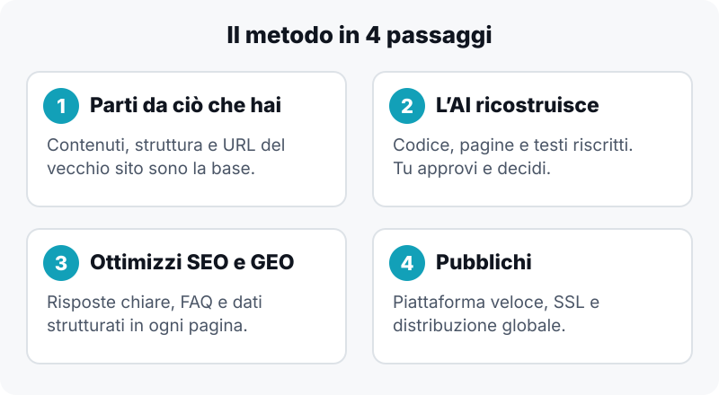
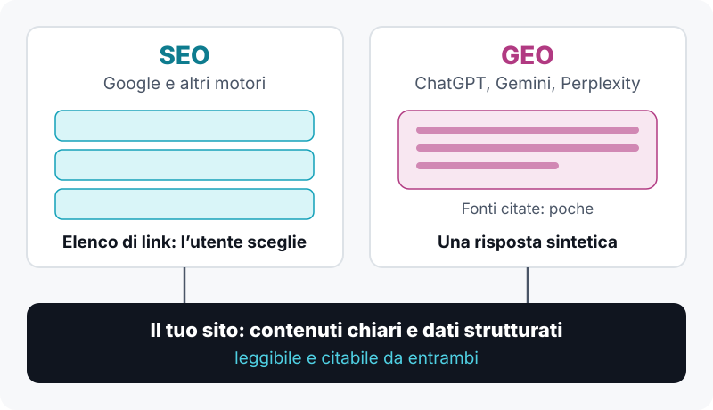
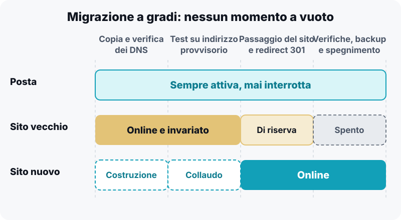

**In breve:** un sito WordPress invecchiato si può rifare partendo dai contenuti che hai già, usando l’AI per riscrivere codice, struttura e testi. Con una migrazione ordinata non perdi né il posizionamento né la posta elettronica. Il nuovo sito è più veloce, più sicuro e pensato per essere trovato sia su Google (SEO) sia nelle risposte di ChatGPT, Gemini e Perplexity (GEO).

## Perché il sito di molte PMI è fermo da anni

Il sito aziendale viene quasi sempre costruito una volta, con un tema WordPress e una manciata di plugin, e poi lasciato lì. Dopo qualche anno i sintomi sono sempre gli stessi:

-   pagine lente, soprattutto da smartphone;
-   plugin da aggiornare e rischi di sicurezza;
-   testi scritti per un’azienda che non c’è più;
-   un design che non rispecchia il livello reale del lavoro.

Rifarlo sembra un progetto enorme, e per questo si rimanda. Ma oggi il costo di un rifacimento non è più quello di una volta.

## Cosa significa “rifare il sito con l’AI”

Non vuol dire chiedere a un chatbot di “farmi un sito”. Vuol dire usare l’AI come un team di sviluppo e redazione molto veloce, mentre tu mantieni la direzione. Il metodo che ho applicato al mio sito, [emiliozucca.com](https://emiliozucca.com), ha quattro passaggi.

1.  **Si parte dal sito esistente.** Contenuti, struttura delle pagine e URL vengono clonati e diventano la base del nuovo progetto. Google conosce già quelle pagine: buttarle via significa ripartire da zero.
2.  **L’AI ricostruisce, tu approvi.** Con uno strumento di sviluppo assistito come Claude Code, il sito viene riscritto in un progetto moderno, senza il peso di WordPress. Tu guardi, correggi, decidi il tono e le priorità. L’AI esegue in tempi molto più brevi ciò che prima richiedeva settimane di lavoro manuale.
3.  **Si ottimizza per SEO e GEO.** Ne parliamo nel dettaglio qui sotto.
4.  **Si pubblica su una piattaforma moderna.** Il sito viene servito da un’infrastruttura pensata per la velocità, come Vercel, con certificato SSL e distribuzione globale incluse, a costi bassi e prevedibili.

## SEO e GEO: farsi trovare da Google e dalle AI

La **SEO** (Search Engine Optimization) serve a posizionarsi su Google. La **GEO** (Generative Engine Optimization) serve a essere citati dai motori di risposta basati su AI, quando un potenziale cliente chiede, ad esempio, “chi può aiutare la mia azienda con l’automazione?”.

Sempre più persone fanno la domanda direttamente a un assistente AI invece di scorrere i risultati di ricerca. Se il tuo sito non è leggibile e citabile da quei sistemi, sei assente proprio dove si formano le prime scelte.

Nel rifacimento si lavora su cinque elementi concreti:

1.  **Risposta diretta all’inizio di ogni pagina.** Un paragrafo breve che dice chi sei, cosa offri e per chi. Le AI estraggono volentieri ciò che è chiaro e autosufficiente.
2.  **Titoli che rispecchiano le domande reali dei clienti**, non slogan generici.
3.  **FAQ vere**, scritte partendo da ciò che i clienti chiedono davvero in telefonata o in preventivo.
4.  **Dati strutturati (schema.org).** Un codice invisibile all’utente che dice alle macchine chi è l’azienda, che servizi offre, dove opera e quali domande risolve.
5.  **Un’idea per pagina.** Ogni pagina risponde a un’esigenza precisa, senza testi riempitivi accumulati negli anni.

Nessuno può garantire di essere citato da un’AI: i criteri non sono pubblici e cambiano spesso. Ma un sito chiaro, strutturato e veloce parte in vantaggio su uno confuso.

## Migrare senza perdere traffico e senza fermare la posta

È il punto che spaventa di più, ed è giusto: un errore qui può costare caro. I tre rischi sono:

-   **perdere il posizionamento**, se gli URL cambiano senza redirect;
-   **interrompere la posta**, se i record DNS (Microsoft 365, strumenti di email marketing) vengono persi nel passaggio;
-   **lasciare il sito irraggiungibile** durante il cambio.

Per evitarli si procede per gradi:

1.  Si copia la zona DNS su un servizio dedicato (ad esempio Cloudflare) e si verifica record per record, in particolare quelli di posta: MX, SPF, DKIM e DMARC.
2.  Si sposta la gestione dei DNS solo dopo la verifica, tenendo il vecchio sito attivo. Il trasferimento del dominio a un altro registrar è un passaggio a parte e facoltativo.
3.  Si testa il nuovo sito su un indirizzo provvisorio.
4.  Si ripuntano i record del sito (solo quelli del sito) verso la nuova piattaforma.
5.  Si impostano i redirect 301 per ogni URL cambiato e si ripresenta la sitemap in Google Search Console.
6.  Il vecchio hosting si spegne solo a verifiche concluse, dopo aver salvato un backup completo.

Il sito vecchio resta online finché quello nuovo non è collaudato, quindi non c’è mai un momento in cui i clienti trovano una pagina vuota. Resta solo un’avvertenza: se la posta è ospitata sullo stesso hosting del sito, va gestita per prima, perché in quel caso spegnere l’hosting la interromperebbe.

## Cosa guadagna concretamente una PMI

-   **Meno manutenzione e meno rischi.** Niente plugin da aggiornare e una superficie d’attacco molto ridotta.
-   **Più velocità.** I siti veloci trattengono più visitatori e la velocità di caricamento è uno dei segnali considerati dai motori di ricerca.
-   **Costi più prevedibili.** Meno canoni di hosting e meno licenze di temi e plugin.
-   **Presenza dove cercano i clienti**, sui motori classici e sugli assistenti AI.
-   **Un sito che rappresenta l’azienda com’è oggi**, non com’era cinque anni fa.

## Quando non conviene

Non è la strada giusta per tutti. Se il tuo sito è un e-commerce complesso, se hai un team che aggiorna ogni giorno i contenuti da WordPress, o se dipendi da plugin molto specifici, serve una valutazione più attenta prima di cambiare piattaforma. Per un sito vetrina, un sito di servizi o un portfolio aziendale, invece, il rifacimento è quasi sempre vantaggioso.

## Il primo passo: capire se il tuo sito è da rifare

Rifare il sito è anche un buon momento per capire dove l’AI può aiutare il resto dell’azienda: se ti interessa, leggi [da dove iniziare con l’AI in azienda](/blog/ai-in-azienda-da-dove-iniziare-se-non-sai-da-dove-iniziare/) o scopri come [innovare i processi](/innovazione-dei-processi/) senza fermare ciò che già funziona.

## Vuoi capire se il tuo sito è da rifare?

In Innovazione PMI aiutiamo le piccole e medie imprese a modernizzare la propria presenza online con l’AI, senza interrompere ciò che già funziona. Raccontaci com’è fatto oggi il tuo sito: ti diciamo con onestà se conviene rifarlo e da dove partire.

[**Richiedi una valutazione gratuita del tuo sito**](/contatti/)
