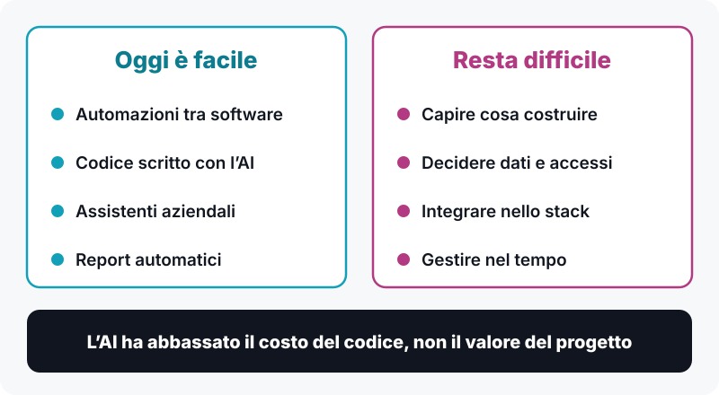
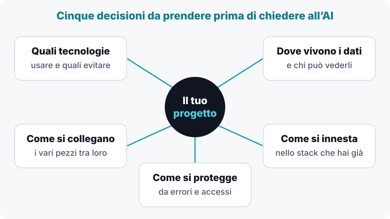
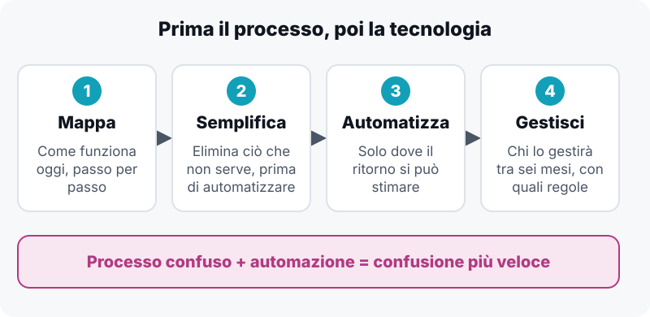

**In breve:** con l’AI scrivere il codice di un’automazione, di un portale o di un sito costa molto meno di prima, e un prototipo si vede in pochi giorni. Non è invece diventato più semplice decidere che cosa costruire, come collegarlo ai sistemi che hai già e chi lo gestirà dopo. Per una PMI il valore sta lì: nel processo e nel progetto, non nel codice.

Fino a pochi anni fa, se una piccola impresa voleva un’automazione, un gestionale su misura o un nuovo sito, doveva mettere in conto settimane di lavoro e budget importanti. Oggi non è più così. Con strumenti come Claude Code si scrive in poche ore ciò che prima richiedeva giorni. Con le piattaforme di automazione si collegano software diversi senza scrivere quasi nulla. Un prototipo funzionante si vede in pochi giorni, non in mesi.

È una buona notizia, e vale la pena dirlo senza giri di parole: le barriere tecniche si sono abbassate davvero. Ma proprio per questo è il momento di essere onesti su ciò che non si è abbassato per niente.

## Cosa è diventato facile

Spesso le PMI non hanno chiaro quanto sia cambiato il quadro. Ecco le quattro cose che oggi sono alla portata di tutti.

-   **Automazioni tra software.** Una fattura che arriva via email, viene letta, registrata nel gestionale e archiviata nella cartella giusta: un flusso che un tempo richiedeva uno sviluppatore dedicato oggi si costruisce in un pomeriggio.
-   **Scrittura assistita del codice.** Un’applicazione interna, un portale per i clienti, uno strumento per calcolare i margini di commessa: l’AI scrive gran parte del codice, e lo fa in fretta.
-   **Assistenti aziendali.** Sistemi che rispondono alle domande dei collaboratori consultando i documenti dell’azienda (procedure, listini, istruzioni operative), invece di interrompere il collega che “sa tutto”.
-   **Reportistica automatica.** Numeri che prima venivano costruiti a mano ogni fine mese in Excel e che ora arrivano da soli.

Tutto vero, tutto accessibile. E allora dov’è il problema?

## Il problema: all’AI bisogna dire come fare

Chi ha provato a usare questi strumenti sa che c’è una differenza enorme tra “chiedere” e “dirigere”. Dire a Claude Code di scrivere un’applicazione produce qualcosa che funziona. Ma funzionare in una demo non è funzionare in un’azienda.

Per ottenere un risultato solido bisogna saper decidere, e decidere prima:

-   quali tecnologie usare e quali evitare;
-   dove vivono i dati e chi può vederli;
-   come si collegano i vari pezzi tra loro;
-   come questa novità si innesta nello stack che l’azienda ha già, senza romperlo;
-   come si protegge tutto questo da errori, accessi indesiderati, aggiornamenti che cambiano le regole.

L’AI esegue con grande velocità le indicazioni che riceve. Se le indicazioni sono sbagliate, produce velocemente un risultato sbagliato, spesso con un aspetto perfettamente convincente. Una configurazione di sicurezza dimenticata, un database lasciato aperto, una scelta che funziona oggi ma non regge quando gli utenti raddoppiano: l’AI non te lo segnala se non glielo chiedi tu, e non puoi chiederlo se non sai che esiste il problema.

In altre parole: l’AI ha abbassato il costo di scrivere il codice. Non ha abbassato il valore di sapere come va progettato.

## Prima il processo, poi la tecnologia

C’è un secondo livello, ancora più a monte. Prima di chiedersi come automatizzare, bisogna chiedersi che cosa si sta automatizzando.

Una regola che vediamo confermata di continuo nelle PMI: se automatizzi un processo confuso, ottieni confusione più veloce. Se un’attività dipende dalla memoria di una sola persona, se ogni collega la fa in modo leggermente diverso, se nessuno sa dire quanto tempo richiede davvero, nessuno strumento potrà salvarti. Anzi, rischia di fissare nel codice un’abitudine sbagliata.

Per questo il lavoro parte sempre da una domanda semplice: come funziona oggi? Si mappano i passaggi, si individuano le attività ripetitive, si stima il tempo che si perde, si capisce dove nascono gli errori. Spesso, già in questa fase, si scopre che metà dei passaggi si può eliminare senza automatizzare nulla. Semplificare prima di automatizzare è il modo più economico di migliorare un’azienda.

Solo dopo, e solo dove il ritorno è stimabile, arriva la tecnologia. Che a quel punto è la parte più semplice. Per un approfondimento sul metodo, leggi come lavoriamo sull’[innovazione dei processi](/innovazione-dei-processi/) e sull’[automazione intelligente](/automazione-intelligente/).

## Un caso concreto: il nostro sito

In questi giorni abbiamo fatto noi stessi quello che consigliamo ai clienti. Il sito di Innovazione PMI, fino a poco tempo fa su WordPress, oggi viene pubblicato tramite Vercel, con un nuovo codice scritto con l’aiuto di Claude Code. Il passaggio, nei suoi aspetti tecnici, è descritto in [questa guida su come rifare il sito con l’AI](/blog/rifare-sito-pmi-con-ai-da-wordpress/).

Sul piano tecnico, il passaggio è stato rapido. È proprio per questo che è un buon esempio: la parte facile si fa in fretta, e può trarre in inganno. Perché il lavoro vero comincia dopo.

Con WordPress, aggiungere un articolo significava aprire un pannello e scrivere. Con un sito costruito in questo modo, la domanda cambia:

-   chi pubblica il prossimo articolo?
-   dove vive il contenuto?
-   come si crea una nuova pagina senza rompere quelle esistenti?
-   che cosa succede se chi l’ha costruito non c’è più?
-   chi si occupa di aggiornamenti, di sicurezza, di controllare che tutto continui a funzionare?

Sono domande che vanno poste in fase di progettazione, non a lavoro finito. Un sito, un’automazione o un’applicazione vanno pensati fin dall’inizio per essere gestiti dopo: da chi, con quali strumenti, con quali regole scritte. Nel nostro caso abbiamo deciso che anche la gestione quotidiana, cioè nuovi articoli e nuove pagine, potesse avvenire con lo stesso approccio assistito dall’AI, e abbiamo strutturato il progetto di conseguenza.

È la differenza tra consegnare un oggetto e consegnare qualcosa che continua a dare valore nel tempo. Un asset generato dall’AI e lasciato a sé stesso invecchia in fretta, e spesso peggio di quello che ha sostituito.

## Svecchiare è un percorso, non un comando

Molte PMI italiane convivono con strumenti, processi e abitudini che hanno vent’anni: Excel usato come gestionale, informazioni sparse tra email e telefono, procedure che esistono solo nella testa di chi lavora lì da sempre. Svecchiare è necessario, e oggi è più accessibile che mai.

Ma svecchiare non significa aprire un assistente AI e scrivere “ammoderna la mia azienda”. È un lavoro articolato, che richiede insieme:

-   **competenza di processo**, per capire che cosa serve davvero;
-   **competenza architetturale**, per scegliere come costruirlo;
-   **capacità di integrazione**, per innestarlo in ciò che già esiste senza fermare l’operatività.

È un percorso a tappe: si parte da dove si perde più tempo, si ottiene un primo risultato misurabile, si impara, si procede. Non una rivoluzione, ma una serie di passi concreti, ciascuno con un ritorno che si può stimare. Se i dati della tua azienda sono sparsi tra più strumenti, un buon punto di partenza è capire [quanto costa davvero avere i dati sparsi](/blog/email-whatsapp-excel-quanto-ti-costa-davvero-avere-i-dati-sparsi/).

## Da dove cominciare

Se guidi una PMI e senti che è il momento di muoverti, ti suggeriamo tre cose semplici.

1.  **Scegli un processo** che oggi ti costa tempo, uno solo, e prova a descriverlo passo per passo. Già questo esercizio rivela molto.
2.  **Chiediti quanto tempo richiede ogni settimana** e chi, in azienda, è l’unico a sapere come funziona.
3.  **Prima di cercare uno strumento, chiediti chi lo gestirà tra sei mesi.**

La tecnologia oggi è alla portata di tutti. Ciò che fa la differenza è sapere dove metterla, come costruirla e come farla durare. È lì che il lavoro di consulenza continua ad avere valore, e continuerà ad averlo.

## Vuoi capire da dove partire nella tua azienda?

Una prima mappatura leggera dei processi è spesso il modo migliore per cominciare: serve a capire dove si perde tempo, che cosa si può semplificare e dove l’AI darebbe un ritorno reale. Scrivici, ti diciamo con onestà da dove conviene partire.

[**Scrivici per una prima mappatura dei tuoi processi**](/contatti/)
