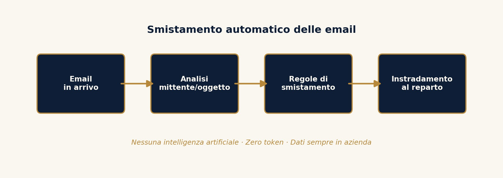
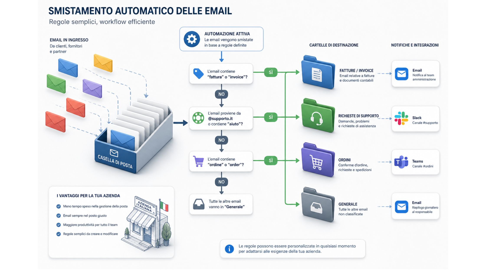

È possibile smistare automaticamente le email in arrivo in azienda senza usare l’intelligenza artificiale? Sì. Nella maggior parte dei casi un workflow basato su regole su mittente, oggetto e parole chiave riconosce correttamente fatture, richieste di supporto e ordini, instradandoli al reparto giusto senza alcun modello di AI, senza consumo di token e senza inviare il contenuto delle email a servizi terzi.

## Il problema comune della gestione delle email nelle PMI italiane

In molte piccole e medie imprese italiane, la casella di posta generica dell’azienda riceve ogni giorno decine di email molto diverse tra loro: fatture dai fornitori, richieste di assistenza dai clienti, ordini, candidature spontanee, comunicazioni della pubblica amministrazione. Qualcuno, di solito una persona amministrativa, legge ogni email e la reindirizza manualmente alla persona o al reparto competente. È un’attività a basso valore, ripetitiva, che consuma tempo ogni giorno e che dipende da una singola persona chiave: se quella persona è assente, le email restano ferme.

Quando si propone di automatizzare questo processo, la prima reazione è spesso: ci vuole l’intelligenza artificiale, deve capire cosa dice l’email. In realtà, nella grande maggioranza dei casi, non serve capire il significato del testo. Serve riconoscere pattern ricorrenti.

## Perché un workflow basato su regole funziona quasi sempre

Le email che arrivano in una casella aziendale seguono schemi molto più prevedibili di quanto si pensi. Una fattura elettronica arriva quasi sempre da un indirizzo riconoscibile, contiene la parola fattura nell’oggetto, oppure ha un allegato con un nome standard. Una richiesta di assistenza contiene tipicamente parole come problema, non funziona, assistenza, supporto. Un ordine contiene parole come ordine, conferma, spedizione.

Un workflow costruito con n8n o Make analizza questi elementi, mittente, oggetto, corpo del messaggio, presenza e tipo di allegati, e applica una sequenza di condizioni per decidere dove instradare l’email. Non c’è interpretazione del linguaggio naturale, c’è corrispondenza di pattern, ed è sufficiente per coprire la stragrande maggioranza dei casi reali.

## Come si costruisce un workflow senza intelligenza artificiale

1.  Si collega la casella di posta aziendale al workflow tramite un trigger che si attiva a ogni nuova email in arrivo.
2.  Si definisce un primo blocco di condizioni sul mittente: se il dominio corrisponde a un fornitore conosciuto, si segue un percorso; altrimenti si passa al blocco successivo.
3.  Si definisce un secondo blocco di condizioni sull’oggetto e sul corpo del messaggio, cercando parole chiave ricorrenti associate a ciascuna categoria.
4.  Si definisce un terzo blocco, se necessario, sulla presenza e sul tipo di allegati.
5.  In base al percorso seguito, l’email viene etichettata, spostata in una cartella specifica, oppure notificata alla persona o al gruppo competente, per esempio tramite Slack, Microsoft Teams o una notifica email.
6.  Si prevede un percorso di default per i casi non riconosciuti, che restano sotto controllo umano, evitando che qualcosa vada perso.

## Cosa fare quando le regole non bastano

Ci sono situazioni in cui il volume di casistiche è talmente ampio, o il linguaggio talmente vario, che un sistema a regole pure diventa complicato da mantenere. In questi casi può avere senso introdurre un modulo di intelligenza artificiale solo per la parte residua, i casi ambigui che le regole non catturano, mantenendo però il grosso del volume gestito dal workflow a costo zero. Questo approccio ibrido massimizza il risparmio e riserva l’uso, e il costo, dell’intelligenza artificiale solo a dove serve davvero.

## Fare a meno della AI quando possibile: il vantaggio sulla protezione dei dati

Un aspetto spesso sottovalutato riguarda la protezione dei dati. Le email aziendali contengono spesso informazioni sensibili: dati di clienti, importi, condizioni contrattuali. Un workflow a regole elabora tutto internamente, senza inviare il contenuto delle email a un modello di intelligenza artificiale esterno. Questo significa meno rischi legati alla riservatezza, e una gestione più semplice rispetto agli obblighi del Regolamento europeo sull’intelligenza artificiale, l’AI Act, che si applica invece quando si utilizzano sistemi di intelligenza artificiale per elaborare informazioni, incluse quelle personali.

## Quanto si risparmia in concreto facendo a meno della AI quando possibile?

Un’elaborazione tramite un modello di intelligenza artificiale ha un costo per ogni email analizzata, legato al consumo di token. Su volumi di centinaia o migliaia di email al mese, questo costo cresce in modo proporzionale e continuo. Un workflow a regole, una volta costruito, ha un costo di esecuzione trascurabile, indipendentemente dal volume, con l’unico costo fisso legato all’abbonamento allo strumento di automazione.

## Fare a meno della AI quando possibile: sintesi

Lo smistamento automatico delle email è uno degli esempi più chiari di come l’[automazione intelligente](/automazione-intelligente/) non significhi necessariamente intelligenza artificiale. Un workflow a regole ben progettato copre la maggior parte dei casi, costa quasi nulla da eseguire e mantiene i dati aziendali dentro il perimetro dell’azienda, semplificando anche il rispetto della normativa sulla protezione dei dati.
